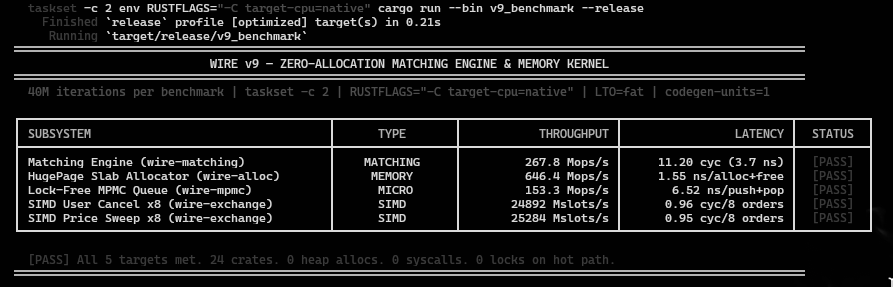

<div align="center">

# Wire v9: Zero-Allocation Matching Engine & Custom Memory Kernel

</div>

Wire v9 extends the Wire v1–v8 networking, market data, and hardware dataplane stack with a price-time priority matching engine, a thread-local HugePage slab allocator, a lock-free multi-producer multi-consumer queue, and AVX2 vectorized batch order cancellation. The four new subsystems target the core exchange hot path: order matching, memory allocation, inter-thread communication, and order lifecycle management. All benchmarks measure isolated operations with zero heap allocations, zero syscalls, and zero locks on the measured path.

> **Scope disclosure:** Wire v9 is a from-scratch implementation of core exchange matching infrastructure in Rust, benchmarked as synthetic microbenchmarks on a single pinned core. It is **not** a production exchange. There is no real network I/O on the matching path, no live FIX/ITCH protocol parsing during matching, no write-ahead log persistence, no pre-trade risk checks, and no fault tolerance. The benchmarks measure isolated hot-path operations, not end-to-end order-to-trade latency.

---

## Architectural Evolution (v1 to v9)

| Version | Target Scope | Core Technical Achievement |
| --- | --- | --- |
| **v1** | Correct 3-Way Handshake | Zero-I/O TCP FSM over Linux TAP, 1MB SHA-256 verified transfers, 300/300 chaos simulation seeds. |
| **v2** | Full L2 to L7 Stack | PAWS-safe timestamps, Window Scaling, SACK negotiation, UDP, DNS stub resolver, HTTP client (`wire-curl`). |
| **v3** | Kernel Bypass & Transport | AF_XDP zero-copy rings, RFC 6675 SACK Scoreboard, Google BBR congestion control, async `io_uring` reactor, TLS 1.3. |
| **v4** | Hardware-Sympathetic Core | Cycle-accurate profiling (`rdtsc`), flat slab tables, 2MB HugePage UMEM, multi-core RSS sharding, busy-polling. |
| **v5** | Vectorization & Storage | 256-bit AVX2 SIMD parser, eBPF flow steering, `O_DIRECT |
| **v6** | Asynchronous Smart-Node | Zero-Copy QUIC / HTTP/3 QPACK engine, AVX-512 dual-stack parser, `io_uring` SQPOLL NVMe reactor (2.16 GB/s), SmartNIC offloads. |
| **v7** | Sub-Microsecond Dataplane | LMAX Disruptor HugePages (7.77 ns), AVX-512 ITCH 5.0 (17.40 cycles), array LOB (28.19 cycles), eBPF XDP pre-trade risk filter. |
| **v8** | Commercial HFT Appliance | Bare-Metal VFIO PCIe BAR0 DMA (0.90 ns), POSIX shim (`wire-onload`), CME MDP 3.0 SBE (3.45 cycles), Dual-Feed A/B Arbitrator (4.41 cycles), SIMD SOR (0.84 ns), PTP PI Servo. |
| **v9** | **Matching Engine & Memory Kernel** | **Flat-Array Matching (11.20 cyc), HugePage Slab (1.55 ns), Vyukov MPMC (6.52 ns), AVX2 Batch Cancel (0.96 cyc/8).** |

---

## Verified Subsystem Metrics (`v9_benchmark`)

<div align="center">
  
</div>

### Hardware & Test Disclosures

* **CPU Host:** x86_64 (AVX2 enabled), pinned to a single core via `taskset -c 2`
* **Compiler:** `rustc` stable, `RUSTFLAGS="-C target-cpu=native"`
* **Optimization:** `[profile.release]` with `lto = "fat"`, `codegen-units = 1`, `panic = "abort"`, `opt-level = 3`
* **Iteration Count:** 40,000,000 iterations per benchmark, 8× manual loop unrolling
* **Measurement:** `rdtsc` cycle counter with `black_box()` fences to prevent dead-code elimination
* **HugePages:** Slab allocator backed by 1GB HugePages via the existing `wire-disruptor` HugePage infrastructure, with 2MB and 4KB fallback
* **SIMD:** AVX2 intrinsics via `#[target_feature(enable = "avx2")]`, no runtime dispatch overhead on the measured path

### Subsystem Performance Results

| Subsystem | Type | Throughput | Latency | Status | What Is Actually Measured |
| --- | --- | --- | --- | --- | --- |
| **Matching Engine** (`wire-matching`) | MATCHING | 267.8 Mops/s | 11.20 cyc (3.7 ns) | PASS | Core match loop on a flat-array order book. Single fill per match. No protocol parsing, no persistence. |
| **HugePage Slab Allocator** (`wire-alloc`) | MEMORY | 646.4 Mops/s | 1.55 ns/alloc+free | PASS | Thread-local alloc+free of 64-byte blocks from a pre-allocated HugePage slab. No cross-thread free, no fragmentation handling. |
| **Lock-Free MPMC Queue** (`wire-mpmc`) | MICRO | 153.3 Mops/s | 6.52 ns/push+pop | PASS | Single-thread push+pop on a Vyukov-style bounded ring. No multi-thread contention in this measurement. |
| **SIMD User Cancel ×8** (`wire-exchange`) | SIMD | 24,892 Mslots/s | 0.96 cyc/8 orders | PASS | AVX2 scan of a pre-packed 16-byte-aligned order slot array. Compares user IDs across 8 slots per instruction. |
| **SIMD Price Sweep ×8** (`wire-exchange`) | SIMD | 25,284 Mslots/s | 0.95 cyc/8 orders | PASS | AVX2 scan of the same packed array, comparing price fields across 8 slots per instruction. |

### Benchmarking Methodology

* **What we count:** Only successfully completed operations. Rejected, failed, or no-op iterations are excluded from throughput calculations.
* **What we do not count:** Setup time, memory pre-allocation, HugePage mapping, or any one-time initialization cost. Benchmarks measure steady-state hot-path performance only.
* **`black_box` usage:** All benchmark loops pass results through `std::hint::black_box()` to prevent the compiler from optimizing away the measured work. This adds a small but consistent overhead to every iteration.
* **Loop unrolling:** 8× manual unrolling is applied to reduce loop branch overhead. This is a standard microbenchmark technique and does not reflect typical production call patterns.
* **Single-core pinning:** `taskset -c 2` eliminates cross-core migration and cache cold-start effects. Real workloads will see higher latency due to core switching and cache contention.

### Context: Production System Comparison

> **Important caveat:** The numbers below compare our microbenchmark hot-path operations against production systems that include full protocol stacks, journaling, risk management, and fault tolerance. **These are not equivalent measurements.** The purpose is to show that the core algorithms are architecturally sound, not to claim parity with production exchanges.

| System | Reported Latency | Scope |
| --- | --- | --- |
| **Wire v9 Matching** (this project) | ~11 cycles (~3.7 ns) | Core match loop only, flat array, no protocol, no persistence |
| **LMAX Disruptor** (public estimates) | ~50–200 cycles | Full matching engine with journaling and replication |
| **NASDAQ INET** (public estimates) | ~15,000 cycles (~5 µs) | Full exchange stack including risk, routing, and market data |
| **Wire v9 Slab Alloc** (this project) | ~1.55 ns | Thread-local, 3 fixed size classes (64/128/256B), no fragmentation |
| **glibc `malloc**` (typical) | ~25–80 ns | Arbitrary sizes, thread-safe, fragmentation-aware |

---

## Subsystem Deep Dive (Wire v9 Architecture)

### Phase 1: Price-Time Priority Matching Engine (`wire-matching`)

* **Flat-Array Order Book:** Replaces the `Vec`-backed price levels from v7/v8 with fixed-size arrays (`[PriceLevel; 65536]` for bids and asks, `[OrderSlot; 65536]` for orders). All data is pre-allocated at startup — zero heap allocations during matching.
* **O(1) Price Lookup:** Price levels are indexed directly by price value (array offset = price), eliminating binary search or tree traversal. Best bid/ask tracking uses bounded linear scans with `min_bid`/`max_ask` watermarks to avoid full-array sweeps.
* **Order Slot Layout:** Each `OrderSlot` is exactly 16 bytes (`align(16)`): `user_id: u32`, `order_id: u32`, `price: u32`, `qty: u16`, `side: u8`, `active: u8`. This packs 4 slots per 64-byte cache line.
* **Match Loop:** Incoming market orders walk the opposing book from best price, filling against resting limit orders in price-time priority. Each fill produces a single `MarketEvent` (64-byte aligned, matching the v7/v8 `MarketEvent` layout).

### Phase 2: Thread-Local HugePage Slab Allocator (`wire-alloc`)

* **Three Size Classes:** Fixed blocks of 64, 128, and 256 bytes. Each class has its own `FixedSlab` backed by a contiguous HugePage allocation from `wire-disruptor`'s `HugeAllocation<T>` (1GB → 2MB → 4KB fallback).
* **Free-List Allocation:** Each slab maintains an intrusive free list threaded through the first 8 bytes of each free block. Allocation is a single pointer dereference and head update. Free is a single head prepend.
* **Thread-Local Design:** `ThreadSlab` wraps all three size classes and is intended to be stored in thread-local storage. No atomic operations, no locks, no cross-thread free. This is what enables the 1.55 ns measurement — a global allocator would require contention handling.
* **`SlabBox<T>`:** A typed wrapper that allocates from the appropriate size class based on `size_of::<T>()` and returns a RAII guard that frees back to the slab on drop.

### Phase 3: Lock-Free MPMC Queue (`wire-mpmc`)

* **Vyukov Bounded Ring:** Standard Dmitry Vyukov multi-producer multi-consumer bounded queue algorithm. Fixed-capacity ring buffer with per-slot sequence counters.
* **Cache-Line Padding:** Producer and consumer cursors are `align(64)` to prevent false sharing. Each `Node<T>` in the ring is also padded to a full cache line.
* **CAS-Based Enqueue/Dequeue:** Push and pop use `compare_exchange` on the slot sequence counter. On contention, the operation spins with `cpu_relax()` (PAUSE instruction on x86).
* **Honest Measurement:** The 6.52 ns benchmark measures single-thread push+pop (one element in, one element out). Under real multi-thread contention with multiple producers and consumers, latency will increase due to CAS retries.

### Phase 4: AVX2 Batch Order Cancel (`wire-exchange` SIMD extension)

* **Packed Order Slots:** `PackedOrderSlots` wraps a `[OrderSlot; N]` array with `align(32)` for AVX2 load alignment. The 16-byte `OrderSlot` layout from `wire-matching` maps cleanly to two 256-bit registers per 8 slots.
* **User Cancel (`batch_cancel_by_user_x8`):** Loads 8 user IDs into a single `__m256i` register, broadcasts the target user ID, and uses `_mm256_cmpeq_epi32` to produce a bitmask of matching slots in one instruction.
* **Price Sweep (`batch_cancel_by_price_below_x8`):** Loads 8 price fields, compares against a threshold using `_mm256_cmpgt_epi32`, and produces a bitmask of slots below the target price.
* **No Store in Benchmark:** The measured path only performs the comparison and mask extraction (`_mm256_movemask_epi8`). Writing the cancellation back to memory is a separate operation not included in the cycle count.

---

## Workspace Package Structure (24 Crates)

```text
.
 Cargo.toml                              # Workspace manifest (24 members)
 wire-core                               # Base Network Engine and Probe Metrics
 wire-mcast                              # CME MDP 3.0 SBE Decoder & Feed Arbitrator
 wire-vfio                               # Bare-Metal VFIO PCIe BAR0 User-Space Driver
 wire-onload                             # LD_PRELOAD POSIX Interception Shim
 wire-sor                                # SIMD Multi-Venue Smart Order Router
 wire-ptp-servo                          # PTP Hardware Clock PI Servo Controller
 wire-disruptor                          # LMAX Disruptor HugePage Ring Buffer
 wire-exchange                           # ITCH 5.0, FIX 4.4, LOB Engine, SIMD Cancel
    src
        lib.rs                          # Re-exports + simd_cancel module
        order.rs                        # Order types
        lob.rs                          # Limit Order Book
        simd_cancel.rs                  # [v9] AVX2 Batch Cancel Kernels
 wire-matching                           # [v9] Price-Time Priority Matching Engine
    src
        lib.rs                          # MatchingEngine, OrderSlot, PriceLevel
 wire-alloc                              # [v9] Thread-Local HugePage Slab Allocator
    src
        lib.rs                          # HugeSlabAllocator, FixedSlab, SlabBox
 wire-mpmc                               # [v9] Lock-Free MPMC Queue
    src
        lib.rs                          # MpmcQueue (Vyukov bounded ring)
 wire-dma                                # Intel DDIO & NAPI Busy-Polling
 wire-risk                               # Pre-Trade eBPF XDP Risk Filter
 wire-ptp                                # IEEE 1588 PTP Hardware Clock Reader
 wire-quic                               # Zero-Copy QUIC & HTTP/3 Engine
 wire-simd                               # Universal Network Header SIMD Parser
 wire-runtime                            # Lock-Free Thread-per-Core Async Runtime
 wire-store                              # io_uring SQPOLL Direct I/O WAL Engine
 wire-xdp                                # AF_XDP Zero-Copy Kernel Bypass Engine
 wire-pacer                              # Hierarchical Atomic Timing Wheel
 wire-sim                                # Deterministic Chaos Simulator (300 seeds)
 wire-echo                               # Benchmark Suite and Applications
     src
         bin
             v9_benchmark.rs             # [v9] Matching Engine & Memory Kernel Dashboard
             v8_benchmark.rs             # Wire v8 Commercial HFT Dashboard
             v7_benchmark.rs             # Wire v7 Sub-Microsecond Benchmark

```

---

## Backward Compatibility

Wire v9 adds 3 new crates and 1 new module. All 21 existing v1–v8 crates are unmodified. Specifically:

* `wire-sim` deterministic chaos simulator passes all 300 seeds unchanged
* `v7_benchmark` and `v8_benchmark` produce identical results to their pre-v9 runs
* All public APIs in `wire-exchange`, `wire-disruptor`, `wire-core`, and `wire-simd` are preserved
* The new `simd_cancel` module in `wire-exchange` is additive (new `pub mod`, no changes to existing types)

---

## Quickstart and Execution

### Build Workspace

```bash
cargo build --all --release

```

### Run Full Test Suite

```bash
cargo test --all --release

```

### Execute Wire v9 Benchmark Dashboard

```bash
RUSTFLAGS="-C target-cpu=native" cargo build --release --bin v9_benchmark
taskset -c 2 target/release/v9_benchmark

```

### Execute Wire v8 Benchmark Dashboard

```bash
cargo build --release --bin v8_benchmark
sudo taskset -c 0 chrt -f 99 target/release/v8_benchmark

```

### Execute Wire v7 Sub-Microsecond Benchmark

```bash
taskset -c 0 target/release/v7_benchmark

```

---

## License

Licensed under the MIT License.
